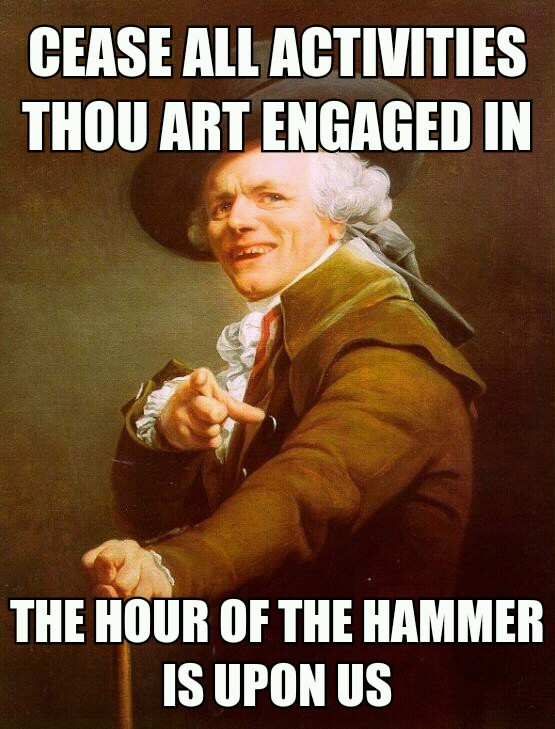
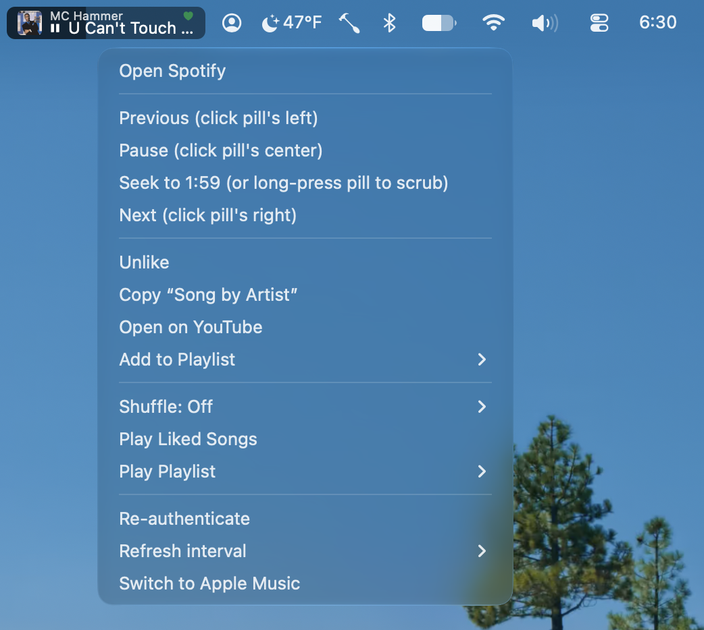
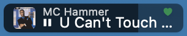

# Hammertunes.spoon

<p align="center">
  <br>
  <em>Stop! Hammertunes.</em>
</p>

A [Hammerspoon](https://www.hammerspoon.org/) menubar pill that shows what's
playing, with artwork, a progress bar, and playback controls.

**Spotify** is well tested. **Apple Music** support is in beta, with only basic
functionality tested so far.

<p align="center">
  
</p>

## Install

You need macOS, Hammerspoon, and either the Spotify desktop app or Music app.

With Homebrew:

```sh
brew install --cask tokenmaxxr/tap/hammertunes
```

Or with git:

```sh
git clone https://github.com/tokenmaxxr/Hammertunes.spoon \
  ~/.hammerspoon/Spoons/Hammertunes.spoon
```

Add one of these to `~/.hammerspoon/init.lua`.

**Spotify** (the default):

```lua
hs.loadSpoon("Hammertunes")
spoon.Hammertunes:start()
```

**Apple Music:**

```lua
hs.loadSpoon("Hammertunes")
spoon.Hammertunes:start({ backend = "applemusic" })
```

Then choose **Hammerspoon menu bar > Reload Config**.

Both players support now-playing, playback controls, scrubbing, copy, and shuffle
without additional setup. Spotify's playlists and likes need the
[optional extras](#spotify-extras-optional). Apple Music requires no
authentication; a subscription is only needed to stream catalog tracks, not to
play purchased or imported music.

You can [switch players from the menu](#switching-players) later.

## Controls



The pill shows cover art, artist, and song title. Its background fills from left
to right as the song plays. **⏸** means playing, **▶** means paused, and **♥**
marks a liked/favorite track (Spotify green or Apple Music red).

Hover for the full track, artist, album, and available playlist information.
When nothing is playing, the pill becomes **♪**; clicking it opens a menu to
open the player or switch players.

### Click zones

The pill has left, center, and right click zones:

```
   [    ◀ Previous    |    ⏸ Play / Pause    |    Next ▶    ]
          left                center              right
```

| Gesture | Where | Action |
| --- | --- | --- |
| **Click** | Left | Previous track, or restart the current track if more than about 3 seconds in |
| **Click** | Center | Play / Pause |
| **Double-click** | Center | Copy "Song by Artist" |
| **Click** | Right | Next track |
| **Press and hold** (about 1 second) | Anywhere | Seek to the position under your cursor |
| **Hold, then drag** | Anywhere | Scrub through the track |
| **⌘-drag** | Anywhere | Move the pill in the menubar |
| **Right-click** | Anywhere | Open the menu below |

Playback controls and scrubbing update the pill immediately, regardless of the
refresh interval you choose.

### Right-click menu

The menu includes playback controls, **Seek to `M:SS`** at the position you
right-clicked, **Shuffle**, **Like/Favorite**, **Copy "Song by Artist"**,
**Open on YouTube**, **Add to Playlist**, and **Play Playlist**.
Availability depends on your player and track, as described below.

**Refresh interval** sets how often the pill checks the player (1 / 2 / 3 / 5 /
10 seconds; 3 seconds by default). Shorter intervals pick up changes made in the
player sooner but use more battery. Progress continues between checks.

The menu also offers [player switching](#switching-players) and
[updates for git installs](#updates).

## Spotify extras (optional)

For playlists, like/unlike, **Play Liked Songs**, the playing-context name in the
tooltip, and the Smart Shuffle indicator, choose **"Enable Spotify extras…"**
from the right-click menu. It guides you through creating a free Spotify
developer app and approving access in your browser. Hammertunes also offers this
setup once when first run without authentication.

The login is saved in the macOS Keychain. Use **Re-authenticate** if you need to
sign in again.

<details>
<summary>Manual authentication</summary>

1. Go to <https://developer.spotify.com/dashboard> and choose **Create app**.
2. Set the **Redirect URI** to exactly `http://127.0.0.1:53127/callback`.
3. Copy the app's **Client ID**, then authenticate once (opens a browser):

```lua
hs.loadSpoon("Hammertunes")
spoon.Hammertunes:authenticate("YOUR_SPOTIFY_CLIENT_ID")
spoon.Hammertunes:start()
```

Remove the `:authenticate(...)` line afterward; later launches need only
`:start()`.

</details>

**Add to Playlist** lists playlists you own. **Play Playlist** shows your
library with recently played playlists pinned on top. This lets Discover Weekly
and Release Radar appear even if you haven't followed them. Both menus show cover
thumbnails.

**Smart Shuffle** is display-only; change it in Spotify. Regular shuffle can
be toggled from the pill.

## Apple Music (beta)

Library tracks support artwork, favorite/unfavorite, and adding to playlists.
**Play Playlist** lists your library playlists without cover thumbnails.

### Streaming tracks

On macOS Tahoe, catalog tracks that aren't in your library show title, artist,
and progress, but artwork is usually unavailable. **Favorite** and **Add to
Playlist** are hidden for these tracks. Playback controls and **Play Playlist**
still work.

### Other sources

**Show Other Sources** displays now-playing information from browsers and other
apps. It is off by default and always excludes Spotify.

These sources, including unidentified ones, are display-only: copy and YouTube
search work, but playback controls, seeking, and shuffle are unavailable.
**Play Playlist** still starts the selected playlist in Music.

[Report issues](https://github.com/tokenmaxxr/Hammertunes.spoon/issues) if you
encounter problems with the beta.

## Switching players

Choose **"Switch to Spotify"** or **"Switch to Apple Music"** from the right-click
menu. That choice is saved and overrides the player selected in `init.lua` on
later launches, so you can switch without editing your config.

## Updates

Use the command matching your installation:

```sh
brew upgrade --cask hammertunes
```

After upgrading, reload Hammerspoon via **menu bar > Reload Config** to load
the new code.

```sh
git -C ~/.hammerspoon/Spoons/Hammertunes.spoon pull
```

For git installs, `make -C ~/.hammerspoon/Spoons/Hammertunes.spoon update` is
also available. Git installs check for updates on launch and offer **"Update
available"** in the right-click menu; installation starts only when you click it.
To disable the check, set `spoon.Hammertunes.checkForUpdates = false` before
`:start()`.

## Development

Contributions, bug reports, and Apple Music testing are welcome.

Clone into a directory **without** the `.spoon` extension and symlink it into
place. Hammerspoon claims that extension: double-clicking a `.spoon` folder in
Finder moves it into `~/.hammerspoon/Spoons/`, taking your checkout with it.

```sh
git clone https://github.com/tokenmaxxr/Hammertunes.spoon ~/git/Hammertunes
ln -s ~/git/Hammertunes ~/.hammerspoon/Spoons/Hammertunes.spoon
```

Run syntax checks and unit tests without Hammerspoon (requires `lua` and
`luac` on `PATH`):

```sh
make test
```

## License

MIT - see [LICENSE](LICENSE).
